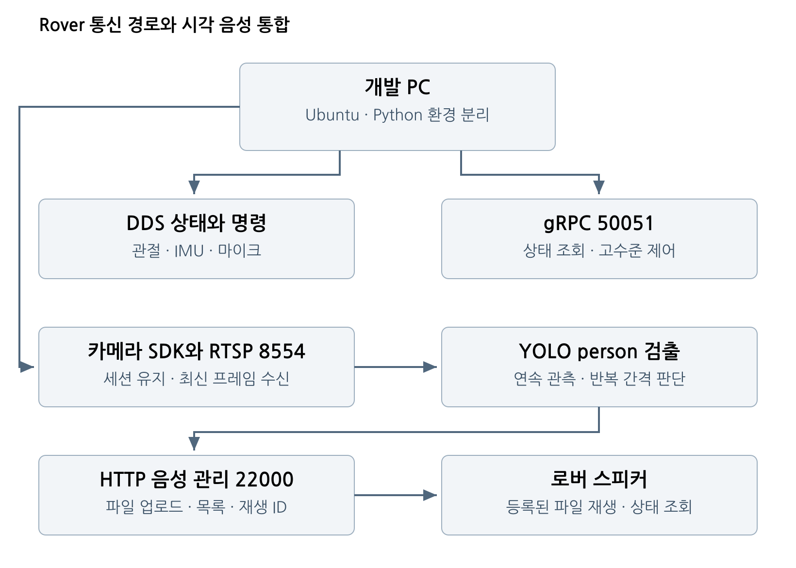

# DOBOT Rover 통신과 시각 음성 통합

Ubuntu 개발 PC에서 DOBOT Rover의 **DDS 상태 수신, gRPC 고수준 제어, RTSP 카메라, HTTP 음성 업로드와 재생, YOLO 사람 검출**을 연결한 실습 기록과 실행 안내서다.

2026년 9월 30일부터 10월 20일까지의 현장 실습을 기반으로 한다. 실기 확인 결과, 패킷 분석 결과, 코드 구현 및 로컬 시험을 구분하여 재현할 수 있도록 정리했다. 사용자 보고에 따른 통합 시험의 성과는 사람을 검출하고 로버 스피커로 인사하는 인지와 행동의 연결이다. 현재 코드는 규칙 기반이며, 언어 지시를 해석하는 학습형 VLA 정책은 별도 연구 단계다.

## 구현 범위

| 기능 | 핵심 경로 | 확인 근거 |
|---|---|---|
| 관절각 및 온도 수신 | Ethernet DDS | 10월 8일 사용자 성공 확인 |
| 고수준 통신 | gRPC 50051 | 상태 조회 성공, 사용 가능 동작 27개 응답 |
| 카메라 표시 | RTSP 8554 over TCP | ffplay 실시간 재생 성공 |
| 마이크 수신 | DDS VoiceState | 15초 WAV, 150개 메시지, PCM 480000 bytes |
| 음성 업로드와 재생 | HTTP 22000 | 업로드 완료와 등록 ID 및 isPlay 확인 |
| 사람 인식 | YOLOv8n COCO | person 검출 및 인사 이벤트 로그 |
| HTTP 통합 v4 | RTSP + YOLO + HTTP | 코드 및 모의 HTTP 시험, 버전별 실기 범위는 검증표 참조 |

**용어:** 기존 실습에서 성공한 영상 주소는 `rtsp://192.168.1.6:8554/camera1`이다. 본 문서에서는 이를 RTSP over TCP로 표기한다. SRTP 암호화 스트림이나 SRT를 구축했다고 해석하지 않는다.

[Word 종합 보고서 다운로드](reports/Rover_Integration_Report_KO.docx) · 29쪽, 10개 장

## 처음 읽는 순서

1. [프로젝트 결과와 구조](docs/00-overview.md)
2. [Ubuntu와 SDK 설치](docs/01-setup.md)
3. [DDS 저수준 통신과 모터 시험](docs/02-low-level.md)
4. [gRPC 고수준 제어](docs/03-high-level.md)
5. [RTSP 카메라 구축](docs/04-camera.md)
6. [마이크 음성 수신](docs/05-microphone.md)
7. [음성 업로드와 재생 ID](docs/06-http-audio.md)
8. [YOLO 시각 음성 통합](docs/07-integration.md)
9. [시험 결과와 오류 해결](docs/08-validation.md)
10. [출처와 버전](docs/09-sources.md)

## 기존 성공 환경에서 빠르게 실행

저장소를 `~/rover-integration`에 두고 기존 카메라·비전 환경을 유지한다. YOLO 가중치는 이미 사용하던 `yolov8n.pt`를 명시한다. 음성은 로버에 먼저 등록되어 있어야 한다.

~~~bash
# 처음 내려받을 때
git clone https://github.com/harok7054-gif/Rovertesting.git "$HOME/rover-integration"

cd ~/rover-integration/examples/greeting_http

# 음성 목록과 재생용 ID 확인
python3 rover_http_voice.py list

# 등록된 인사말 한 번 재생
python3 rover_http_voice.py play-once \
  --voice-name greeting_original

# 환경 경로만 확인
python3 run_rover_greeting_http_v4.py \
  --model "$HOME/dobot_quad_sdk/rover_greeting_v1/yolov8n.pt" \
  --check

# 카메라와 사람 인식만 시험
python3 run_rover_greeting_http_v4.py \
  --model "$HOME/dobot_quad_sdk/rover_greeting_v1/yolov8n.pt" \
  --detect-only

# 사람 인식 후 로버에 등록된 인사말 재생
python3 run_rover_greeting_http_v4.py \
  --model "$HOME/dobot_quad_sdk/rover_greeting_v1/yolov8n.pt" \
  --voice-name greeting_original --interval 8
~~~

종료는 영상창 `q` 또는 터미널 `Ctrl+C`. 통합 시험에는 모터 명령과 `kill_robot`가 필요하지 않다. 초기 환경의 실제 사용자명은 `jdman`이었으며, 문서의 `$HOME`은 실행 PC의 홈 디렉터리를 뜻한다.

## 코드와 자료

| 경로 | 내용 |
|---|---|
| `examples/greeting_http/` | 기존 v4 실행기, 사람 검출, HTTP 음성 클라이언트, 모의 서버 시험 |
| `examples/audio_receiver/receiver.py` | 동적 DDS 타입을 조회하는 마이크 전용 수신기 |
| `examples/dds_audio_send/voice_send_v2.py` | 초기 유선 DDS PCM 송신 방식 보존 |
| `tools/camera_keepalive.py` | 문서의 카메라 세션 예제를 독립 스크립트로 정리 |
| `tools/grpc_readonly_probe.py` | 생성된 RPC stub을 통한 상태와 동작 목록 조회 |
| `config/cyclonedds.example.xml` | 실제 인터페이스 이름을 넣어 사용할 예시 |
| `evidence/` | 음성 수신 수치와 비식별화한 HTTP 관측 요약 |
| `docs/` | 단계별 상세 설명과 명령, 합격 기준, 오류 대응 |
| `reports/` | Word 종합 보고서 |

SDK, 모델 가중치, 원본 음성·영상·PCAP, 제조사 내부 유지관리 도구는 배포 패키지에 포함하지 않는다. 모델과 SDK는 각 출처의 조건을 따른다.

## 검증

~~~bash
cd examples/greeting_http
python3 test_http_voice.py
~~~

이 시험은 `127.0.0.1` 모의 서버만 사용한다. 로봇 스피커 재생이나 카메라 성능을 대신 검증하지 않는다. 최신 v4에서 `wolf.mp3`의 청취 확인과 장시간 통합 측정은 별도의 현장 결과로 기록한다.
